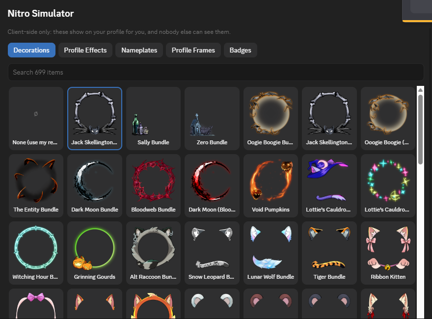
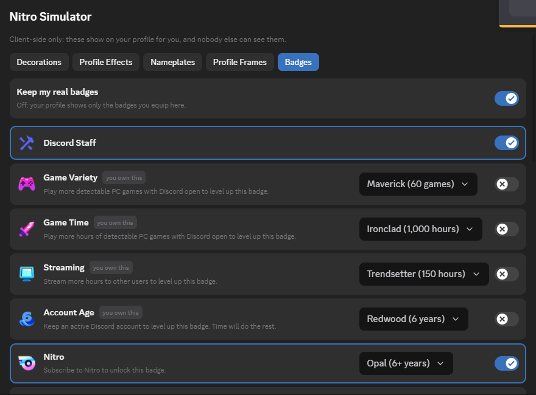
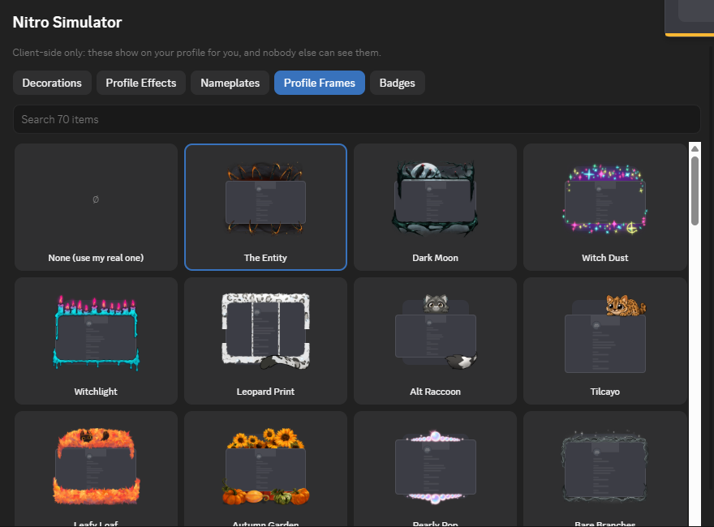

# NitroSimulator

A BetterDiscord plugin that lets you try on any Discord cosmetic on your own profile: avatar decorations, profile effects, nameplates, profile frames and badges, at any level.

**Everything is client-side.** Only you see it, on your own Discord. Nothing is sent to Discord and nothing changes for anyone else.

## Features

- **Real Discord items.** Everything comes from Discord's own shop catalog, so new drops show up without an update: 690+ decorations, 360+ profile effects, 290+ nameplates and 70 profile frames.
- **Badges with levels.** Equip any badge from Discord's badge list. Badges with tiers have a level picker: Nitro from Starter to Opal, Server Boosting levels 1–9, Game Variety, Game Time, Streaming, Account Age and Gifting. The icons are Discord's real badge art.
- **Inside Discord's profile editor.** A *Nitro Simulator* section appears in **User Settings → Edit Profiles**, under Discord's own options.
- **Discord's badge page agrees.** Clicking a badge on your profile opens Discord's badge directory with your equipped level shown as owned.
- **Keep or replace your real badges.** With "Keep my real badges" on, equipped badges are added to the ones you have. Off, your profile shows only the badges you picked.
- **Clean off switch.** Disabling the plugin puts everything back immediately.

## Install

1. Download [`NitroSimulator.plugin.js`](https://raw.githubusercontent.com/ce017/NitroSimulator/main/NitroSimulator.plugin.js). Right-click → *Save link as*.
2. Move it into your BetterDiscord plugins folder. You can open it from **User Settings → Plugins → Open Plugins Folder**. On Windows it is `%appdata%\BetterDiscord\plugins`.
3. Turn on **NitroSimulator** in **User Settings → Plugins**.

## Use

- Open **User Settings → Edit Profiles** and scroll to **Nitro Simulator**. Click Decoration, Effect, Nameplate, Frame or Badges to pick.
- Or open the plugin's settings (the gear next to it in the Plugins list) for the same picker.
- Choose **None (use my real one)** to go back to what you actually own.

Hover a decoration or nameplate to see it animated.

## Notes

- This is cosmetic and local. Other people still see your real profile.
- It is not on the BetterDiscord addon store. The store doesn't accept plugins that unlock Nitro features, so install it manually as shown above.
- If you also use a plugin that changes profile cosmetics (for example YABDP4Nitro's fake decoration and effect options), turn those options off to avoid the two fighting over the same profile.
- Discord changes its client often. If something stops showing, open an issue.

## License

[MIT](LICENSE)
